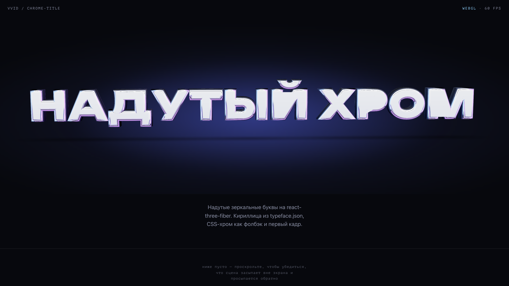
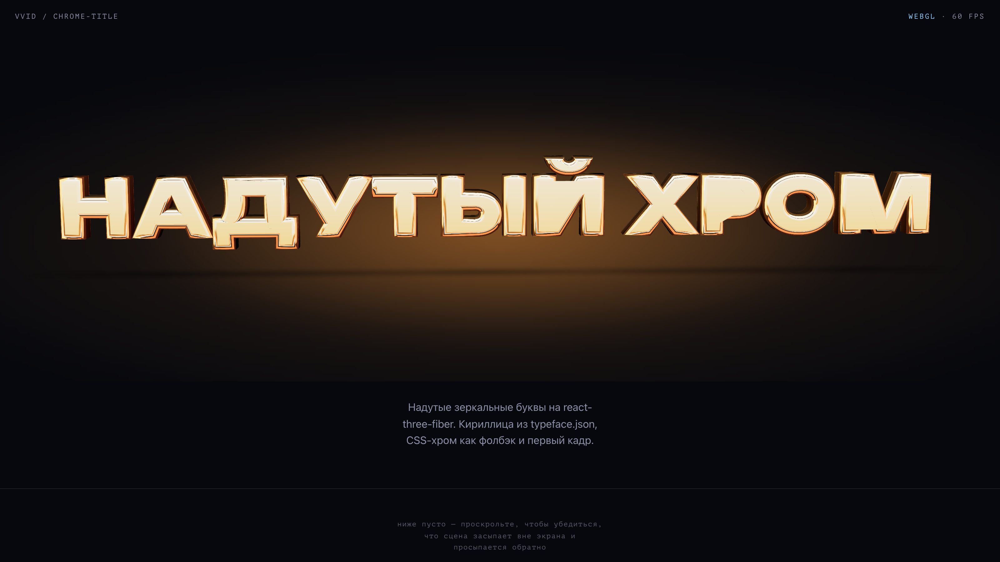
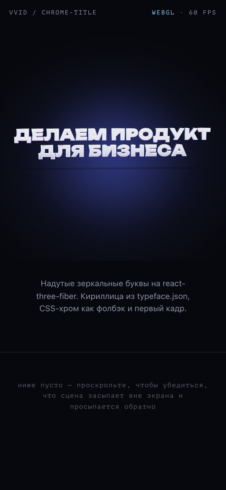
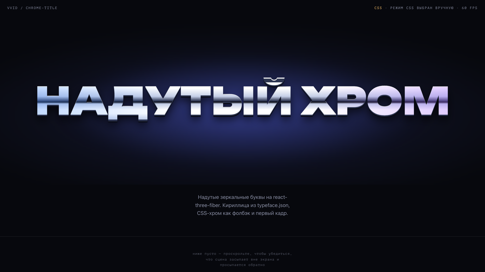

# ChromeTitle — надутый хром

Hero-заголовок из зеркальных 3D-букв на `@react-three/fiber` + `drei`, с кириллицей, фолбэком на CSS и настоящим `<h1>` для поисковиков и скринридеров.



| gold | мобильный перенос | CSS-фолбэк |
| --- | --- | --- |
|  |  |  |

Ролик с курсором: [docs/clip.mp4](docs/clip.mp4) · [docs/clip.gif](docs/clip.gif)

## Запуск

```bash
npm install
npm run dev        # http://localhost:5178 — демо с панелью (h — спрятать)
npm run build      # dist/
npm run capture    # скрины + ролик в docs/ (нужен Google Chrome и ffmpeg)
```

Параметры демо живут в URL: `?text=…&tint=gold&font=rubik&size=0.8&mode=css&interactive=0&panel=0`.

## Использование

```tsx
import { ChromeTitle } from './chrome-title'
import './chrome-title/fonts.css' // @font-face Unbounded / Rubik 900 для CSS-слоя

<ChromeTitle
  text="ДЕЛАЕМ ПРОДУКТ ДЛЯ БИЗНЕСА"
  fontUrl="/fonts/unbounded-black.typeface.json"
  fontFamily="Unbounded"
  tint="cool"
  interactive
  size={0.86}
/>
```

Компонент — это `<div class="chrome-title">` с `aspect-ratio: 16/7`; высоту и ширину задают снаружи (`className` / `style`). Canvas растягивается на весь блок, `<h1>` лежит по центру.

### Пропсы

| проп | по умолчанию | что делает |
| --- | --- | --- |
| `text` | — | текст; `\n` — принудительный перенос, иначе сам переносится на 2 строки, когда одной строкой выходит мельче `minFontPx` |
| `fontUrl` | `fonts/unbounded-black.typeface.json` | typeface.json для 3D (см. ниже) |
| `fontFamily` | `Unbounded` | CSS-семейство того же шрифта — для фолбэка и первого кадра; `@font-face` объявляет страница |
| `tint` | `cool` | `cool` (голубой/фиолетовый), `gold` (тёплый), `custom` |
| `customTint` | — | переопределения поверх пресета: `accents: [слева, справа]`, `glow`, `highlight`, `base`, `css: {light, mid, dark, shadow}` |
| `interactive` | `true` | поворот за курсором (только `pointer: fine`); idle-покачивание есть всегда |
| `size` | `0.86` | доля ширины контейнера под текст в покое; при `interactive` ближний край в полном повороте растёт на ~6 %, поэтому для впритык-вписывания держите ≤ 0.9 |
| `minFontPx` | `44` | порог переноса на две строки |
| `mode` | `auto` | `auto` — проверка WebGL и девайса; `css` / `webgl` — принудительно |
| `environmentUrl` | — | равнопрямоугольный `.hdr` вместо встроенной студии |
| `geometry` | см. `DEFAULT_GEOMETRY` | `depth`, `bevelSize`, `bevelThickness`, `bevelOffset`, `bevelSegments`, `curveSegments`, `letterSpacing`, `lineHeight`, `roughness` |
| `align` | `center` | `left` — строки прижаты к левому краю бокса (hero с копией слева) |
| `paused` | `false` | остановить рендер-цикл (например, пока поверх hero идёт scroll-фильм) |
| `shadowOpacity` | `0.5` | плотность тени под буквами; на светлом фоне меньше |
| `hoverTint` | — | цвет, в который уходит металл при наведении курсора (3D — lerp цвета материала, CSS — наложение того же текста); только на `pointer: fine` |
| `fitLines` | `false` | каждая строка (по `\n`) заполняет всю ширину сама — короткая строка выходит крупнее, ширины совпадают; если стопка не влезает по высоте, все строки ужимаются одинаково |
| `sway` | `true` | медленное покачивание; `false` вместе с `interactive: false` — полностью статичный заголовок, рендер по требованию |
| `as` | `h1` | тег для реального текста |
| `onModeChange` | — | `(mode: 'webgl' \| 'css', reason?)` — что сейчас показано и почему |

### Что внутри

- **Геометрия.** drei `<Text3D>` в `<Center>` на каждую строку, `size=1`, `height 0.3`, bevel `0.1 / 0.13`, `bevelOffset -0.06` (скругление наполовину съедает контур, наполовину расширяет — тонкие штрихи вроде бревиса над Й не схлопываются), `bevelSegments 14`, `curveSegments 24` (на тач — 12 / 14). Экструзия выходит гранёной, поэтому `geometry.ts` сваривает вершины и пересчитывает нормали — крышки и бока отдельно, иначе на плоских гранях полосы.
- **Материал.** `MeshPhysicalMaterial`: metalness 1, roughness 0.05, clearcoat 1, clearcoatRoughness 0.05.
- **Свет.** `<Environment frames={1}>` из `<Lightformer>`: за камерой — панель с градиентом «небо → горизонт → земля» (его и отражают плоские грани), две белые полосы для жёстких бликов, потолок, цветные стены по бокам (в них живёт тинт), тусклый пол. Запекается один раз.
- **Тени и пятно.** `<ContactShadows>` под буквами; световое пятно за текстом — CSS-градиент, общий для обоих режимов.
- **Движение.** Курсор нормируется по окну, поворот сглаживается экспоненциально (`1 − e^(−dt/0.16)`), сверху — медленное покачивание. `prefers-reduced-motion` → статичная поза, `frameloop="demand"`.
- **Адаптив.** Масштаб считается из метрик шрифта (`ha` глифов) под `viewport.width * size` и 78 % высоты; на две строки режется по пробелу, ближе всего к середине по ширине. Горизонтальный угол обзора камеры фиксирован (~40°), вертикальный выводится из пропорций бокса — иначе в широкой полосе hero края заголовка уезжали в «рыбий глаз» и при повороте вылетали за canvas.
- **Перф.** three/r3f/drei — отдельный чанк (≈245 KB gzip), грузится через `React.lazy`, когда блок в 320 px от вьюпорта; первый кадр страницы ждёт только React (48 KB gzip). Вне экрана — `frameloop="never"`. `dpr` в `[1, 2]` рулит `PerformanceMonitor` (только пока вкладка видна); если fps падает и на dpr 1 — компонент уходит на CSS. Потеря контекста (если браузер не вернул его за 2,5 с), ошибка сцены, `saveData`, `deviceMemory < 2`, ≤ 2 ядра, SwiftShader — тоже CSS. Буквы строятся на главном потоке: 12 букв ≈ 60 мс, 24 буквы ≈ 120 мс на M3 (`curveSegments 24 / bevelSegments 14`); на тач-устройствах `TOUCH_GEOMETRY` (14 / 12) режет это вдвое. Сварка вершин — своя, с числовым ключом вместо строкового из `mergeVertices` (в 4 раза быстрее). Замер в headless Chrome на Metal: 1440×900 @2x — 60–80 fps при движении курсора.
- **Фолбэк и доступность.** `<h1>` всегда в DOM и всегда с текстом. Пока 3D грузится, он и есть заголовок: три слоя (`element` — светлый кант, `::before` — тёмная экструзия, `::after` — хром `background-clip: text` с бегущим бликом). У псевдо-текста пустой alt (`content: attr(data-text) / ''`), чтобы скринридер читал заголовок один раз. Когда сцена нарисовала два кадра, `<h1>` плавно уходит в `opacity: 0`, Canvas — `aria-hidden`.

## В лендинге VVID (без сборщика)

`VVID.dc.html` живёт на React 18 UMD из `vendor/`, поэтому компонент собирается отдельной командой в ES-модуль, который берёт React со страницы (`window.React` / `window.ReactDOM`, см. плагин в `vite.lib.config.ts`), а three/r3f/drei кладёт в свой чанк:

```bash
npm run build:lib   # → ../vendor/chrome-title/{chrome-title.js, lib.js, react-shim.js, ChromeScene.js, three.js, rubik-black + unbounded-black .typeface.json}
                    #   + ../fonts/{rubik,unbounded}-900-{latin,cyrillic}.woff2 и OFL
```

Страница грузит только `chrome-title.js` + `lib.js` + `react-shim.js` (≈ 12 KB), `three.js` (≈ 245 KB gzip) приезжает, когда hero во вьюпорте и WebGL есть. API модуля:

```js
const m = await import('./vendor/chrome-title/chrome-title.js')
const title = m.mount(el, { text: 'СНИМАЕМ ВАШ БИЗНЕС\nС РУЧНОГО ПРИВОДА', fontUrl: './vendor/chrome-title/rubik-black.typeface.json', fontFamily: 'Rubik', align: 'left', size: 0.97, interactive: false, hoverTint: '#ff6f61', tint: 'custom', customTint: {…} })
title.update({ text: '…', paused: true })   // язык, calm, film-run
title.unmount()
```

В `VVID.dc.html`: разметка — `<div class="hero-chrome" ref="{{ setChromeTitle }}">` вместо старого `<h1 class="hero-kin">`; стили `.hero-chrome`; `@font-face` Rubik (и Unbounded); в логике — `CHROME_TINT`, `CHROME_GEOMETRY` (трекинг для капса), `chromeProps()`, `initChromeTitle()` (вызывается из `boot()`), синхронизация через `MutationObserver` на классах `<html>` (film-run → `paused`, vcalm → без курсора) и `matchMedia('(max-width:760px)')` (2 строки ↔ 4 строки: `t.heroChrome` / `t.heroChromeNarrow`). `film-src/make-dist.sh` копирует `vendor/` и `fonts/` целиком, так что в `dist/` всё попадает само; скрипт падает, если `vendor/chrome-title/chrome-title.js` не собран.

## Шрифт с кириллицей → typeface.json

Three.js читает шрифты в формате typeface.json. Обычно его делают на [facetype.js](https://gero3.github.io/facetype.js/), но там легко потерять кириллицу (нужно ставить галочку «Reverse font direction» для некоторых OTF и вручную прописывать charset). Здесь — скрипт, который делает то же самое из командной строки и всегда берёт кириллицу:

```bash
# TTF/OTF/WOFF → JSON. По умолчанию: latin + latin-1 + cyrillic + типографика (№ € ₽ — « » …)
node scripts/make-typeface.mjs font-src/Unbounded-Black.ttf public/fonts/unbounded-black.typeface.json

# добавить расширенную кириллицу (казахский, татарский…) или отдельные символы
node scripts/make-typeface.mjs my.otf out.json --charset latin,cyrillic,cyrillic-ext --chars "→✓"

# всё, что есть в шрифте (большой файл)
node scripts/make-typeface.mjs my.otf out.json --all
```

Скрипт печатает, каких букв кириллицы в шрифте нет. Если буквы вышли «вывернутыми» (контур залит, тело пустое — бывает у CFF-based OTF), добавьте `--reverse`.

`npm run fonts` пересобирает оба комплектных шрифта. Unbounded Black и Rubik Black — OFL, лицензии в `font-src/`. Третий, Borsok (`font-src/Boorsok.ttf`, Dastan Miraj, 2018), пришёл архивом без лицензии, в самом файле «All rights reserved» — условия использования нужно подтвердить у автора; сконвертирован командой `node scripts/make-typeface.mjs font-src/Boorsok.ttf public/fonts/boorsok.typeface.json --chars "₽№«»—"`, woff2 — `fonttools ttLib.woff2 compress`. Для CSS-слоя рядом лежат woff2-подмножества (`public/fonts/*.woff2`), объявлены в `src/chrome-title/fonts.css`.

Чтобы подключить свой шрифт: сконвертировать `.ttf` → `.typeface.json`, положить woff2 и `@font-face` с тем же именем, передать `fontUrl` и `fontFamily`.

## Сменить HDRI или тинт

**Своя студия/HDRI.** Передайте `environmentUrl="/env/studio.hdr"` — тогда вместо Lightformer-студии подхватится равнопрямоугольный `.hdr` через `<Environment files>`. Для хрома нужна карта с резкими контрастами: белые полосы на тёмном, иначе буквы серые.

**Свой набор полос.** Студия собрана в `LightformerStudio` в `src/chrome-title/ChromeScene.tsx`. Главное — панель за камерой с градиентом из `useHorizonMap`: плоские грани отражают именно её, полоса v ≈ 0.53–0.61 — то, что видно на буквах в покое, ±0.1 при наклоне за курсором. Остальные полосы — блики на скруглениях.

**Тинт.** `tint="cool" | "gold"` берут пресеты из `TINTS` (`src/chrome-title/types.ts`): `accents` — цвета боковых стен (левая, правая), `glow` — пятно и цветная полоса под горизонтом, `highlight` — холод/тепло белых бликов, `base` — цвет самого металла, `css` — полосы CSS-градиента. Свой — `tint="custom"` + `customTint={{ accents: ['#ff4fa3', '#45f0c8'], glow: '#ff4fa3' }}`; поля можно задавать частично, остальное возьмётся из `cool`.

## Файлы

```
src/chrome-title/
  ChromeTitle.tsx   обёртка: h1, фолбэк, решение webgl/css, lazy-загрузка сцены
  ChromeScene.tsx   Canvas, студия из Lightformer, буквы, тени, курсор, PerformanceMonitor
  geometry.ts       сварка экструзии в «подушку»
  metrics.ts        ширина строк из метрик шрифта / canvas, перенос на две строки
  capabilities.ts   проверки WebGL и девайса, media-query и IntersectionObserver-хуки
  types.ts          пропсы, пресеты тинта, геометрия по умолчанию
  chrome-title.css  бокс, пятно, CSS-хром
  fonts.css         @font-face для Unbounded / Rubik
src/demo/           демо-страница с панелью
scripts/make-typeface.mjs   конвертер шрифтов
scripts/capture.mjs         скрины и ролик через headless Chrome
font-src/           исходные TTF и лицензии
public/fonts/       typeface.json + woff2
```
